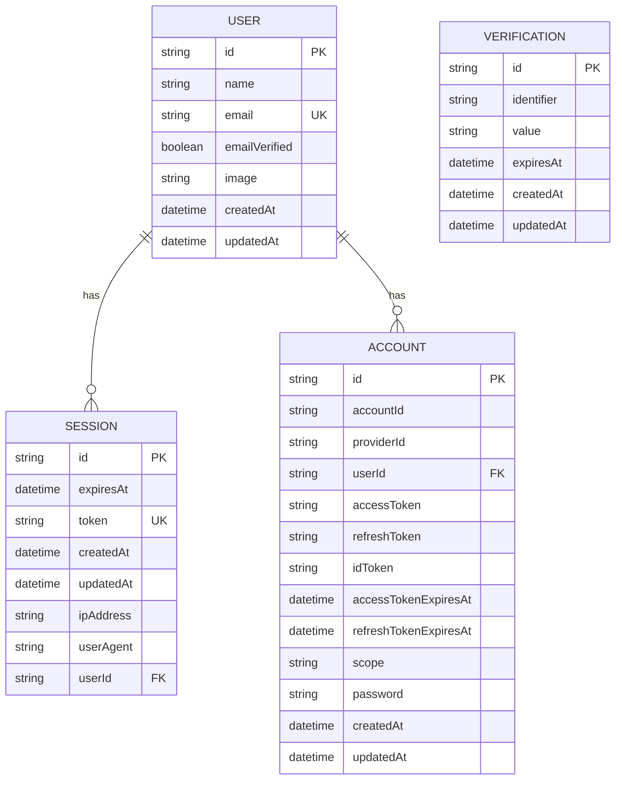

# Authentication model

These Better Auth models are implemented in the current Prisma schema.

Better Auth sessions and accounts belong to a user and are deleted when that user is deleted. Verification records are standalone. The auth user is not currently linked to the proposed customer model.
