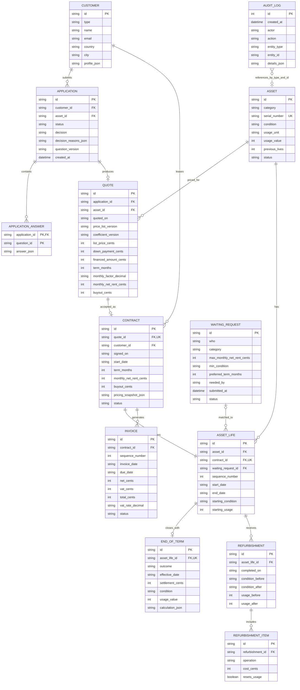

# Leasing model

This diagram is a proposed logical model. Only `Asset` and `AuditLog` are currently implemented in Prisma.

`APPLICATION.asset_id` is also a foreign key to `Asset`; it is omitted from the relationship lines for readability. `AuditLog` is polymorphic: `entity_type` and `entity_id` can refer to any changed entity, so the dotted asset link is illustrative and is not a database foreign key.
